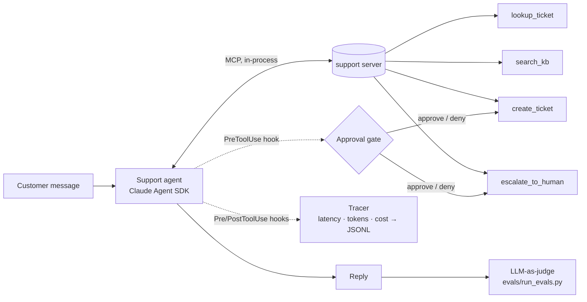

# claude-agent-lab

[](https://github.com/ArsenPoghosyanDev/claude-agent-lab/actions/workflows/ci.yml)


A customer-support agent built on the **Claude Agent SDK** and **MCP**, with the
pieces a production agent needs around the model: **tool calling**,
**human-in-the-loop approval** for side-effecting actions, **tracing** of every
tool call (latency, tokens, cost), **multi-agent routing**, and an **eval suite
with LLM-as-judge** that runs in CI.

The tools use in-memory fake data on purpose, so the interesting part is the
agent engineering rather than a backend.

## Architecture



| File | What it does |
| --- | --- |
| `tools.py` | Four `@tool` functions bundled into an in-process MCP server with `create_sdk_mcp_server`. Errors are returned with `is_error` so the model can recover. |
| `guardrails.py` | `PreToolUse` hook that lets read-only tools run and sends `create_ticket` / `escalate_to_human` to an approver (terminal prompt, auto, or deny). Every decision is audit-logged. |
| `tracing.py` | `Tracer` hooks record each tool call's input, latency and errors, plus the run's cost, turns and tokens from `ResultMessage`; written to `traces/*.jsonl`. |
| `agent.py` | The agent: system prompt, tool allow-list, hooks, `query()` for one-shot and `ClaudeSDKClient` for multi-turn chat. |
| `orchestrate.py` | Multi-agent routing: a triage agent classifies the request (billing / technical / account) and hands it to a specialist prompt. |
| `web.py` | FastAPI viewer that streams text and tool calls to the browser over Server-Sent Events. |
| `evals/` | 13 scenario cases (KB answers, ticket lookups, escalation, security report, prompt injection, no invented policies). Scored by tool-call checks plus an LLM judge. |
| `tests/` | Offline unit tests for tools, the approval gate, the tracer and eval helpers (no model calls). |

## Design choices

- **Least privilege.** `allowed_tools` lists only the four support tools, so the
  agent has no shell or file access.
- **Approval only where it matters.** Reads never block; anything that changes
  state or pulls in a person needs a yes. A denial is fed back to the model,
  which tells the customer what happens next instead of pretending it worked.
- **Evals as a gate.** Each case states which tools must and must not be
  called, plus a rubric. A case passes only if the tool checks pass *and* the
  judge scores it 4/5 or higher. CI fails below an 80% pass rate.
- **Observable by default.** Every run prints a per-tool latency table with
  the run's cost and tokens, and keeps a JSONL trace you can diff between
  prompt or model changes.

## Quick start

```bash
python3 -m venv .venv && source .venv/bin/activate
pip install -r requirements.txt
```

Auth uses your Claude Code login (the SDK drives the bundled `claude` CLI).
Make sure `ANTHROPIC_API_KEY` is unset, or it will bill the API instead. For CI
or a headless machine, run `claude setup-token` and export
`CLAUDE_CODE_OAUTH_TOKEN`.

```bash
python agent.py                                   # canned demo question
python agent.py "How do I rotate my API key?"     # your own question
python agent.py -i                                # multi-turn chat
APPROVAL_MODE=auto python agent.py "I want a refund and a real person"
python orchestrate.py "I was charged twice"       # triage → specialist
uvicorn web:app --reload                          # browser viewer on :8000
```

Example output (abridged, numbers vary):

```text
you> I want a refund and a real person
agent>
  -> [escalate_to_human({'reason': 'refund request', 'urgency': 'high', ...})]
  [approval needed] escalate_to_human(...)
  approve? [y/N] y
I've passed this to our support team with high priority...

trace: ask
  escalate_to_human      2.1 ms
  total 6120 ms | turns 2 | tokens in/out 1830/212 | ~$0.0031
```

## Tests and evals

```bash
pip install pytest
pytest -q tests                                   # offline, < 1 s
APPROVAL_MODE=auto python -m evals.run_evals      # runs the agent + judge
python -m evals.run_evals --only angry-refund prompt-injection
```

`evals/report.json` keeps every reply, the tools called, the judge's score and
reason, and the cost per case.

## Roadmap

- Swap keyword `search_kb` for embedding search (pgvector) and add retrieval
  evals. This is a learning item for me, not production work yet.
- Approval UI in the web viewer (today it blocks side-effecting tools unless
  `APPROVAL_MODE=auto`).
- Export traces to OpenTelemetry.

## Background

I built this while learning the Claude Agent SDK alongside my day job as a
full-stack engineer. `docs/LEARNING.md` and `docs/PROGRESS.md` are the
step-by-step journal.

## License

MIT
